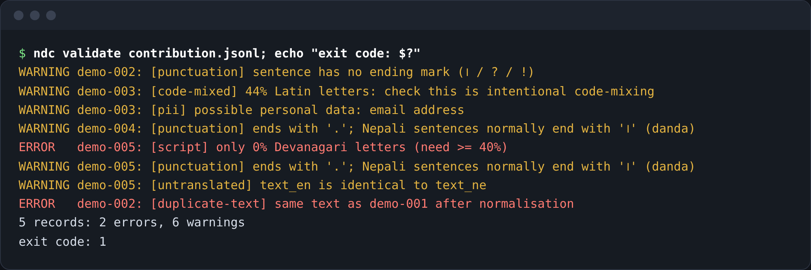
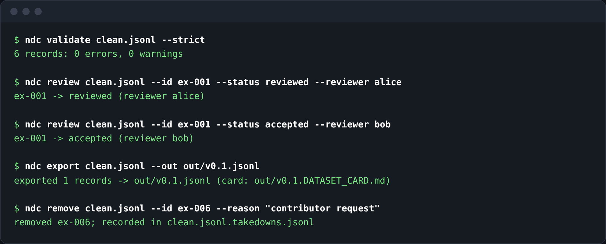

# nepali-data-commons

A small, dependency-free toolkit and workflow for **contributing, reviewing and publishing Nepali-language
text data responsibly**: validate submissions, flag likely personal data and encoding damage, catch
duplicates, require a second person to review, export a clean dataset with a dataset card, and honour
removal requests.

> **Status: v0.1, early.** The checks are heuristics that flag things for humans; they do not verify
> translation quality, naturalness, dialect or offensiveness. The bundled `data/sample.jsonl` has 6 invented
> demo sentences, written with AI assistance and **not reviewed by a native speaker** (see
> [docs/LANGUAGE_REVIEW.md](docs/LANGUAGE_REVIEW.md)).



*Real output of `ndc validate`. The five records are illustrative demo data written for this screenshot (an email address, a duplicate, an English-only record), not real contributions.*



*Real output of the review, export and takedown commands on a copy of the bundled sample file.*

## Why
The community already keeps good *lists* of Nepali datasets (for example `pemagrg1/Nepali-Datasets`,
`theranjitraut/Nepali-Datasets-Collection`, `IOST-ASCOL/nepali-datasets`). Those are links to existing data.
What I did not find is tooling for the *contribution and maintenance* side: how a volunteer submits a new
batch of sentences, how it is checked for personal data and duplicates, who reviews it, and how a bad record
is removed afterwards. That workflow is this project. (Based on reading those READMEs — which contain no
validation or contribution tooling — and web searches; not an exhaustive survey.)

## Features
- **Schema validation** for JSONL records: required licence (`CC0-1.0`, `CC-BY-4.0`, `CC-BY-SA-4.0`), `consent`
  attestation, `source_type` with mandatory `source_url` when not original, closed value sets, unknown-field rejection.
- **Devanagari checks:** script share (hard floor 40%, code-mixing warning above 20% Latin), malformed
  sequences (leading combining marks, double vowel signs, U+FFFD, stray ZWJ/ZWNJ, mixed digit systems),
  suspected **legacy-font text** (e.g. Preeti) with a hint to convert to Unicode first.
- **Personal-data flags** (warnings): Nepali mobile numbers (Devanagari or ASCII digits, `+977`), emails, URLs,
  long digit runs, `@handles` — with tests that ordinary numbers like `१०`, `२०८२`, `रु. ५००` are not flagged.
- **Duplicates:** exact after normalisation (error) and near-duplicates via character 3-gram Jaccard (warning, default 0.85).
- **Review workflow:** `submitted → reviewed → accepted | rejected`; reviewer ≠ contributor; warnings must be
  acknowledged; full `review_history` kept.
- **Export** accepted rows only, to JSONL or CSV, contributor handle hidden by default, plus an auto-generated
  **dataset card** (counts, licences, reviewers, SHA-256, limitations). Mixed licences are refused unless allowed.
- **Language review kept separate from automation:** punctuation/translation heuristics are warnings only;
  `--attests-fluent-nepali` records a *self-declared* fluent reviewer and the dataset card reports the count
  ([docs/LANGUAGE_REVIEW.md](docs/LANGUAGE_REVIEW.md)).
- **Safe CSV export:** UTF-8 with BOM (Excel shows Devanagari correctly) and formula-injection neutralisation.
- **Takedown:** `ndc remove` deletes a record and logs a content-free entry (id, reason, date).

## Install and use
Python ≥ 3.10, no runtime dependencies.
```bash
git clone https://github.com/iamnarace/nepali-data-commons && cd nepali-data-commons
python -m venv .venv && . .venv/bin/activate
pip install -e ".[dev]"

ndc init                                   # print an example record
ndc validate data/sample.jsonl             # exit 1 on errors; --strict also fails on warnings
ndc review data/sample.jsonl --id ex-001 --status reviewed --reviewer alice
ndc review data/sample.jsonl --id ex-001 --status accepted --reviewer bob
ndc export data/sample.jsonl --out out/v0.1.jsonl      # or --format csv; writes out/v0.1.DATASET_CARD.md
ndc remove data/sample.jsonl --id ex-006 --reason "contributor request"
ndc stats data/sample.jsonl
```
(Run on a copy if you do not want to change the sample file.)

Record schema (JSONL, one object per line):
```json
{"id":"ex-001","text_ne":"मलाई नेपाली खाना मन पर्छ।","text_en":"I like Nepali food.","kind":"sentence",
 "domain":"food","region":"","contributor":"demo-contributor","license":"CC0-1.0","consent":true,
 "source_type":"original","status":"submitted"}
```
Optional: `text_en`, `domain`, `region`, `contributor`, `source_url`, `reviewer`, `review_notes`, `review_history`, `created`.

Real output when the commands above were run on a copy of the sample (3 rows accepted, 1 removed):
```
exported 3 records -> out/v0.1.jsonl (card: out/v0.1.DATASET_CARD.md)
removed ex-006; recorded in d.jsonl.takedowns.jsonl
```

## Using the data with nepali-eval
[nepali-eval](https://github.com/iamnarace/nepali-eval) can turn accepted records that have both `text_ne` and `text_en`
into evaluation tasks: `nepali-eval import-ndc out/v0.1.jsonl --out tasks.jsonl --direction ne-en`. The projects share no
code. Status vocabularies differ on purpose: here `accepted` means "a second person reviewed it"; there `reviewed` means
"a named reviewer attested fluency and approved". Imported tasks therefore start as `unreviewed`.
(Available once the nepali-eval pull request that adds `import-ndc` is merged.)

## Development
```bash
ruff check . && python -W error -m pytest -q     # 58 tests
```
`src/nepali_data_commons/{textcheck,records,workflow,cli}.py`. CI runs lint + tests on Python 3.10/3.12/3.13 and
validates every `data/*.jsonl` on pull requests.

## Data, licence, privacy
- Code: Apache-2.0 (`LICENSE`, `NOTICE`). Sample data: CC0-1.0, invented for demonstration.
- Nothing is sent over the network. Contribution files are plain JSONL that you commit yourself.
- Read [docs/GOVERNANCE.md](docs/GOVERNANCE.md): what must never be contributed, consent, review, takedown.

## Known limitations
- Consent/ownership is an attestation the tool cannot verify; reviewer expertise is not verified.
- No offensive-content or toxicity detection. PII detection is regex-based (false negatives for names/addresses).
- Near-duplicate threshold not tuned on real data; no semantic duplicate detection.
- Single-file JSONL workflow suits hundreds–tens of thousands of short records, not massive corpora.
- No speech/audio support.

## Roadmap
Nepali-language docs reviewed by native speakers; offensive-content reviewer aid; optional Hugging Face export;
audio-metadata schema (consent per speaker); ID-pattern PII checks.

## Contributing
See [CONTRIBUTING.md](CONTRIBUTING.md). Correction/removal requests: use the issue template.

## Acknowledgements
Developed with assistance from Claude. No endorsement by any dataset-list maintainer or Nepali
open-source organisation is implied.
